# SmartBelt Vision

Measure pulley speed, belt speed and belt slip from a smartphone video.

Author: Umair

<p align="center">
  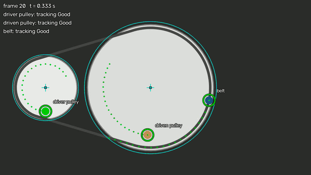
</p>
<p align="center"><sub>Simulated belt drive. A green, an orange and a blue marker are found in every frame; the dots are the recent path of each marker.</sub></p>

SmartBelt Vision follows coloured markers in a video of a belt drive and turns the motion into numbers: rpm of each pulley in every frame, the frequency content of the speed, the speed ratio, the speed loss, and the slip of the belt on each pulley. It runs on your own computer, from a Streamlit app or from the command line. Nothing is uploaded.

- Speed of one pulley in rpm, for every frame, with smoothing, trend removal and a frequency spectrum
- Speed ratio, speed loss and surface speed of a two-pulley belt drive
- Belt speed from a small mark on the belt, and the slip on the driver and on the driven pulley
- Quality of the tracking in every frame (Good, Moderate, Poor, Lost), so weak spots are visible
- Table (CSV), plots (PNG) and a self-contained HTML report
- Validation against simulated videos with known answers, and against your own reference (tachometer or counted turns)

## How it works

<p align="center">
  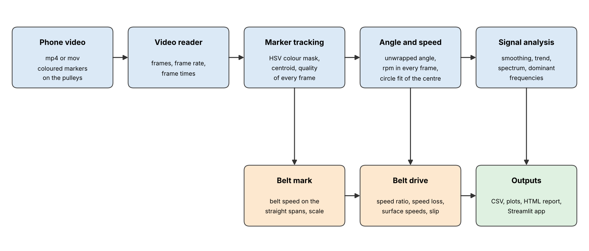
</p>

| Step | What happens |
|---|---|
| Tracking | HSV colour mask, largest blob, centroid. Size, distance and jump checks give a quality for every frame |
| Angle | `atan2` of the marker around the rotation centre, unwrapped; gaps where the marker could have turned more than 90 degrees start a new segment |
| Speed | angular velocity from the angle and the real frame times, in rpm; the mean is total rotation divided by time |
| Signal | short gaps filled, outliers removed, Savitzky-Golay smoothing, trend removed, spectrum with a Hann window |
| Belt drive | measured ratio = driver turns / driven turns, compared with the ratio of the effective radii |
| Slip | belt speed from a straight-line fit of the mark on the straight spans; `slip on driver = (v driver - v belt) / v driver`, `slip on driven = (v belt - v driven) / v belt` |

## The app

```
streamlit run app.py
```

<table>
  <tr>
    <td width="50%">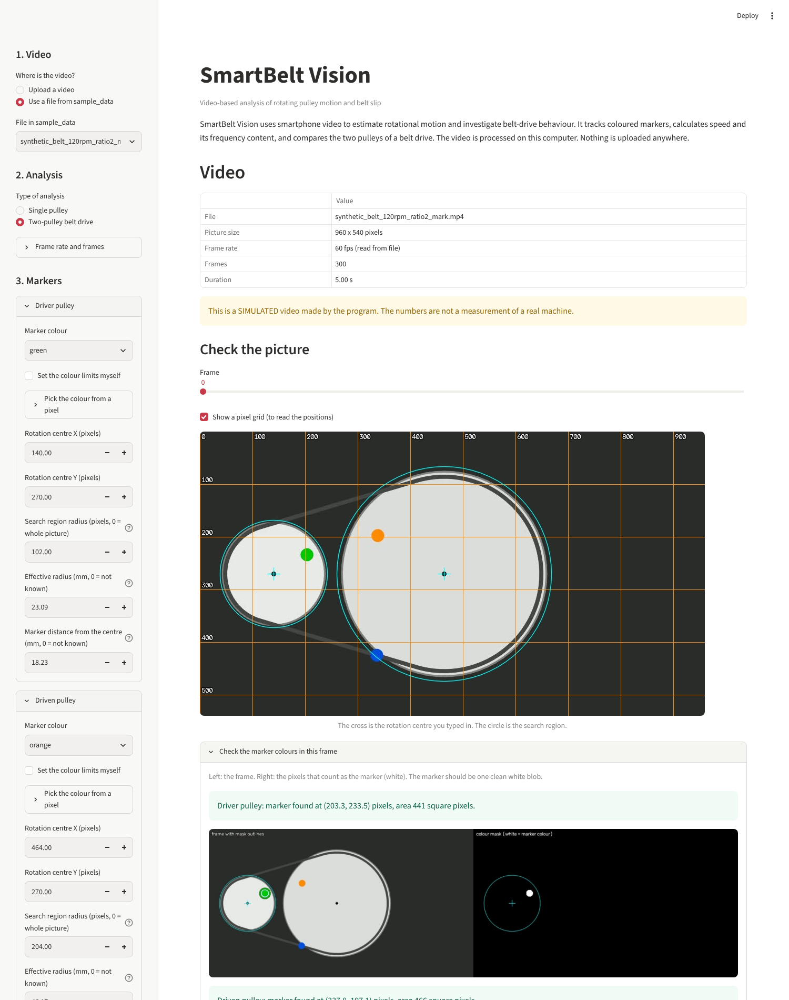</td>
    <td width="50%">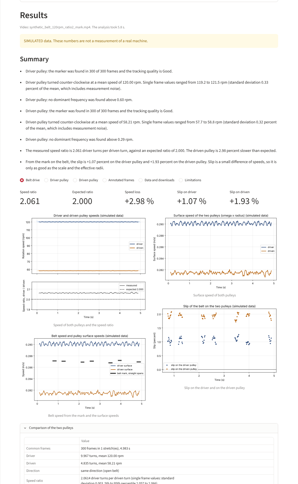</td>
  </tr>
  <tr>
    <td align="center"><sub>Set the markers. The grid, the centres and the search regions are drawn on the frame, and the colour check shows which pixels count as the marker.</sub></td>
    <td align="center"><sub>Run the analysis. Summary, speed ratio, speed loss, slip and the belt drive plots.</sub></td>
  </tr>
  <tr>
    <td width="50%">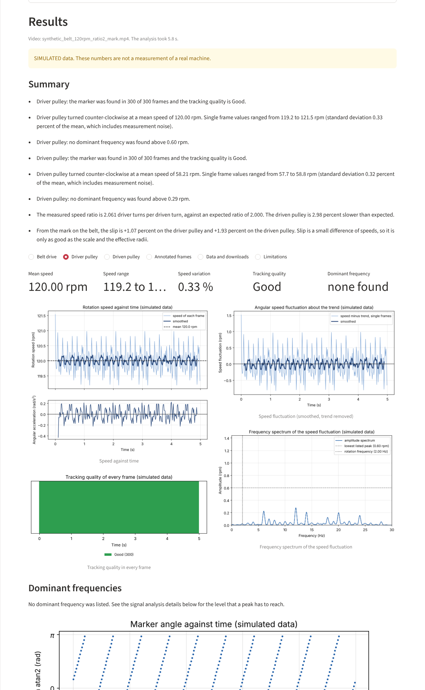</td>
    <td width="50%">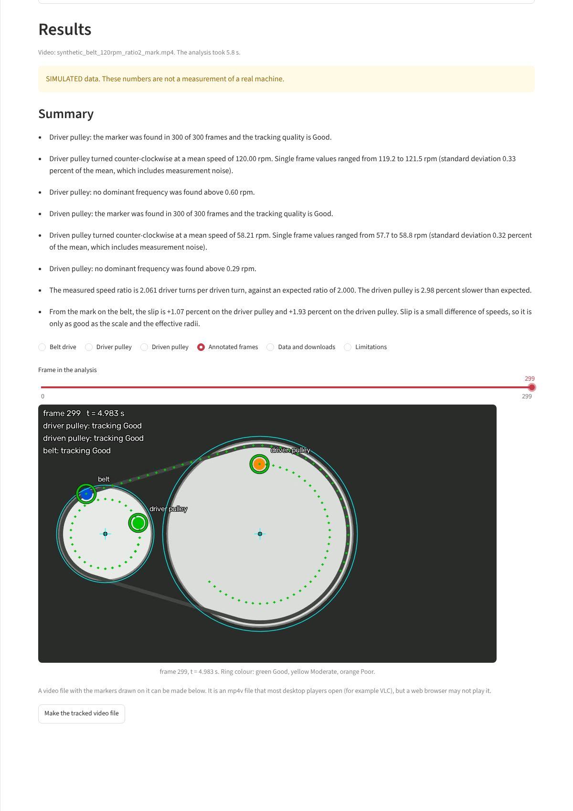</td>
  </tr>
  <tr>
    <td align="center"><sub>One view per pulley: speed, fluctuation, spectrum, dominant frequencies, tracking quality.</sub></td>
    <td align="center"><sub>Annotated frames with a slider. The ring colour is the tracking quality.</sub></td>
  </tr>
  <tr>
    <td width="50%">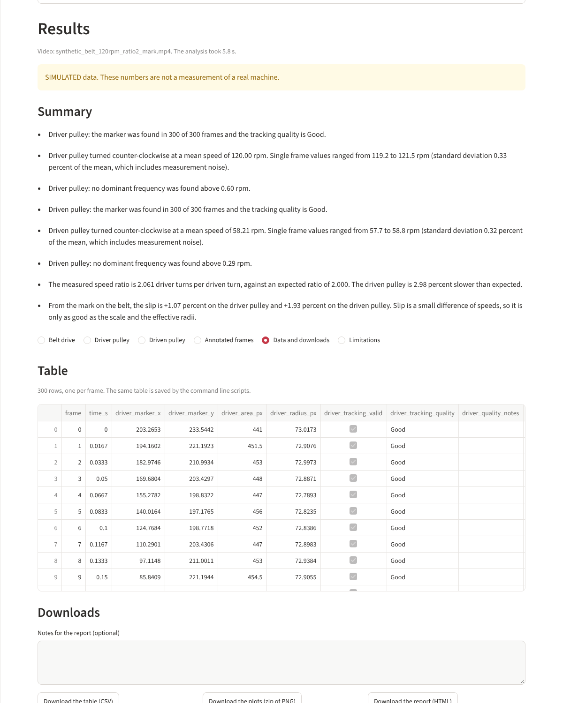</td>
    <td width="50%">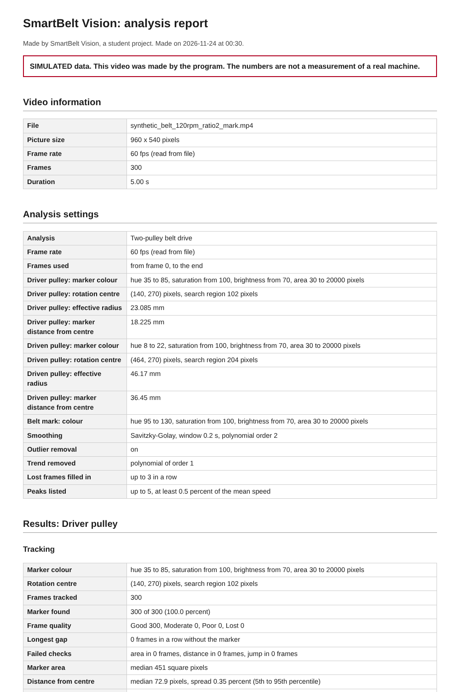</td>
  </tr>
  <tr>
    <td align="center"><sub>The table, and downloads for the CSV, the plots and the report.</sub></td>
    <td align="center"><sub>The HTML report: video facts, settings, results, graphs, definitions and limitations in one file.</sub></td>
  </tr>
</table>

A 90 second walkthrough of the app, with captions and no sound: [assets/demo_app_walkthrough.mp4](assets/demo_app_walkthrough.mp4)

All pictures on this page come from simulated videos that the program makes itself, so the true values are known.

## What the analysis shows

<table>
  <tr>
    <td width="50%">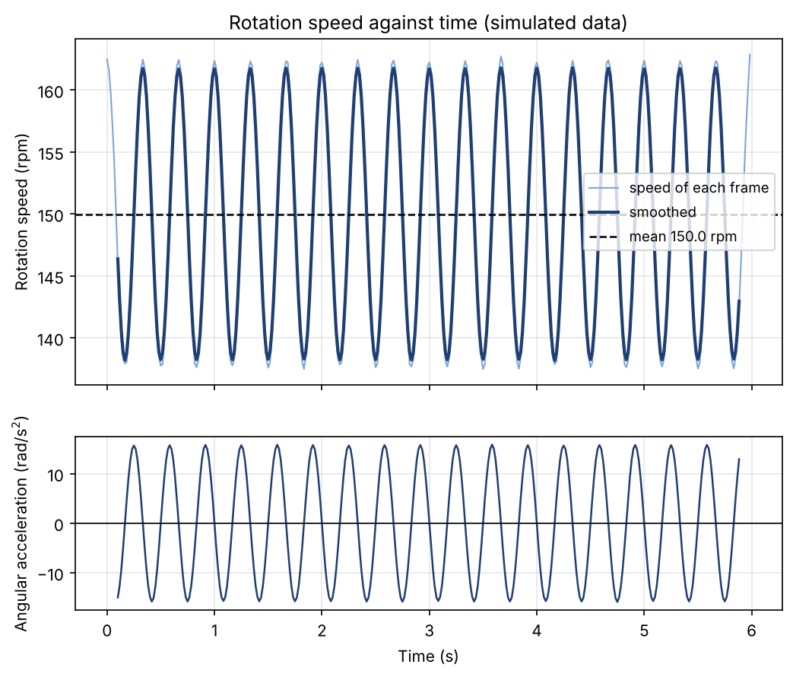</td>
    <td width="50%">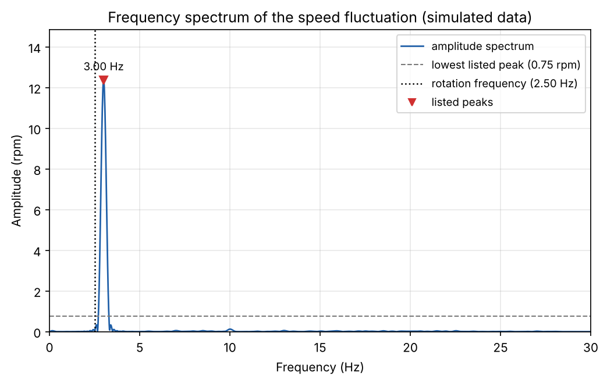</td>
  </tr>
  <tr>
    <td align="center"><sub>Speed in every frame, with the smoothed speed on top.</sub></td>
    <td align="center"><sub>Spectrum of the speed fluctuation. The peak is the 3 Hz wobble that the simulated disc has.</sub></td>
  </tr>
  <tr>
    <td width="50%">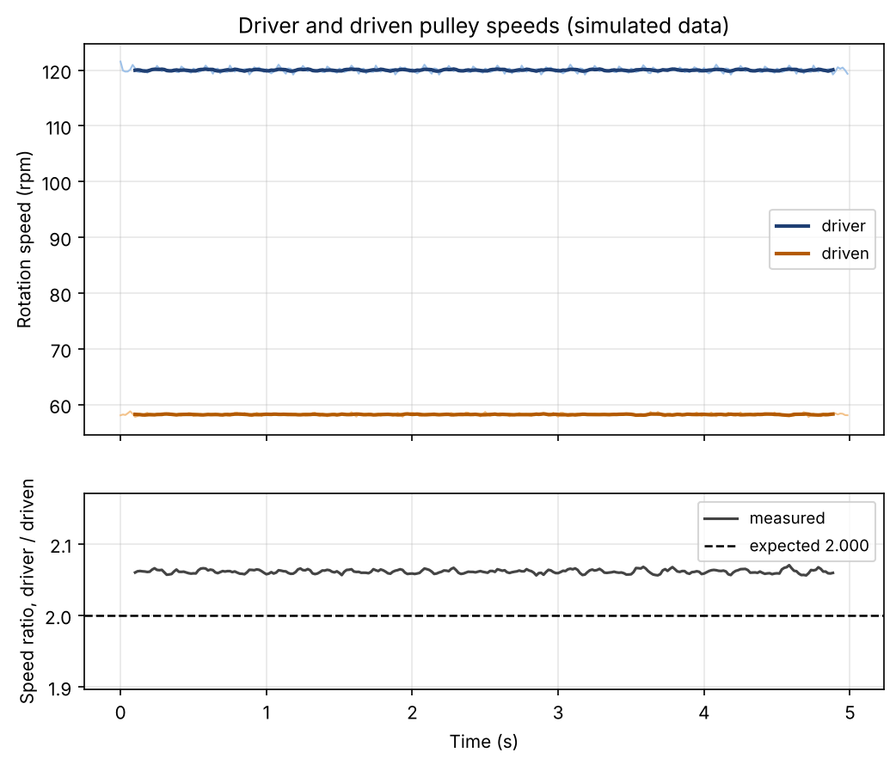</td>
    <td width="50%">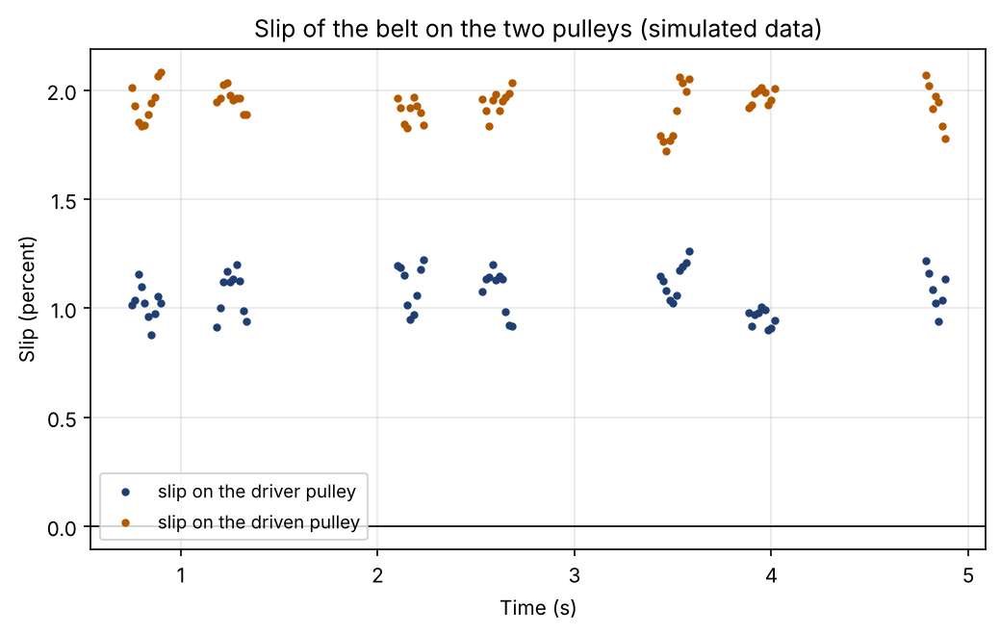</td>
  </tr>
  <tr>
    <td align="center"><sub>Both pulleys and the speed ratio against the expected ratio.</sub></td>
    <td align="center"><sub>Slip on each pulley, from the belt mark. Each dot is one frame on a straight span.</sub></td>
  </tr>
  <tr>
    <td width="50%">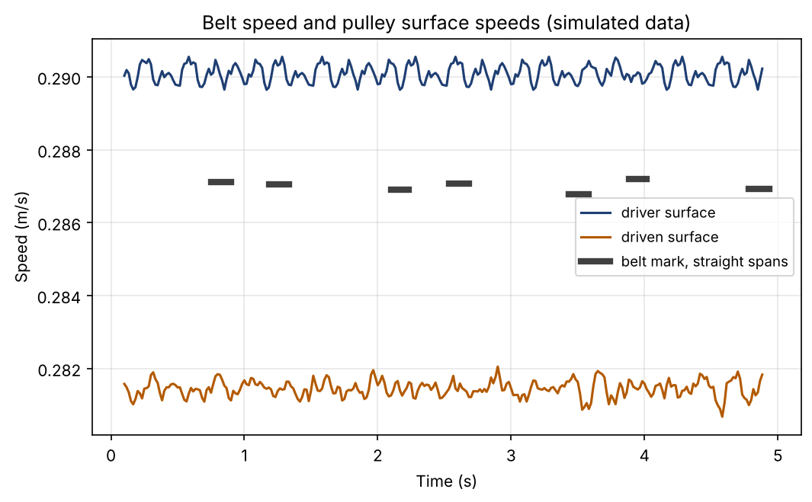</td>
    <td width="50%">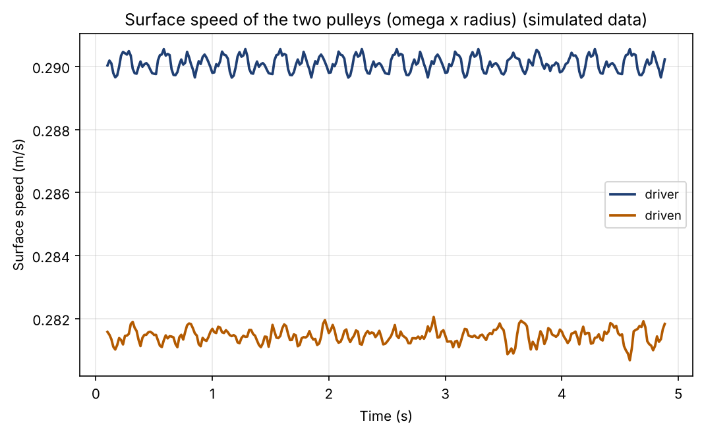</td>
  </tr>
  <tr>
    <td align="center"><sub>Belt speed (black) between the two surface speeds (omega x radius).</sub></td>
    <td align="center"><sub>Surface speed of both pulleys.</sub></td>
  </tr>
</table>

Numbers from these runs (960 x 540, 60 fps, 5 s, simulated):

- Belt drive, ratio 2, driver slip 1 percent, driven slip 2 percent: speed ratio 2.061 against an expected 2.000, speed loss +2.98 percent, slip on the driver +1.07 percent and on the driven pulley +1.93 percent, belt speed 0.2870 m/s from 7 passes
- One pulley at 150 rpm with a 3 Hz wobble of 4 degrees: mean speed 149.96 rpm, dominant frequency 3.00 Hz, amplitude 12.38 rpm (the wobble that was put in is 12.57 rpm)
- Analysis time for 300 frames: 1.1 s for one pulley, 3.4 s for a belt drive with a belt mark

### Check the markers before you run

<table>
  <tr>
    <td width="33%">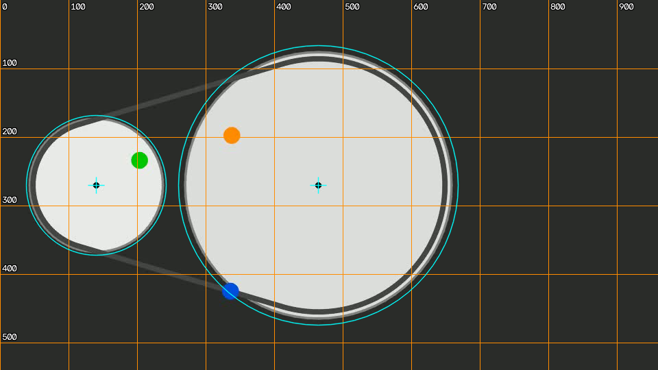</td>
    <td width="33%">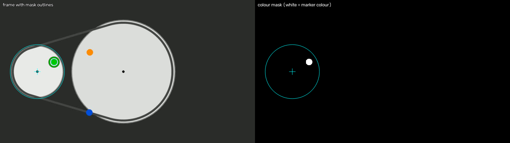</td>
    <td width="33%">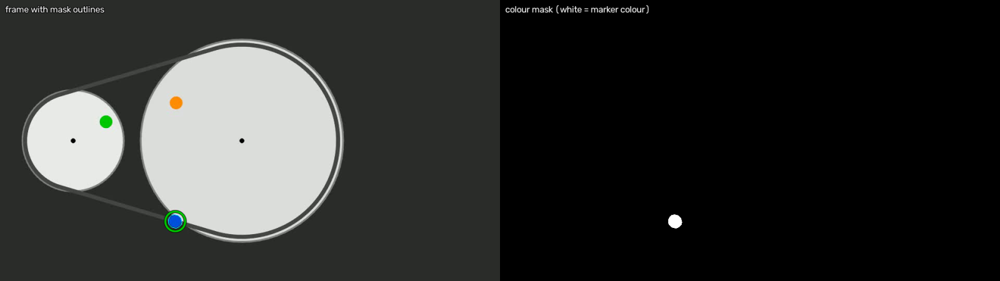</td>
  </tr>
  <tr>
    <td align="center"><sub>Grid, rotation centres and search regions on the first frame</sub></td>
    <td align="center"><sub>Colour mask of the driver marker: one clean white blob</sub></td>
    <td align="center"><sub>Colour mask of the belt mark</sub></td>
  </tr>
</table>

## Validation

<p align="center">
  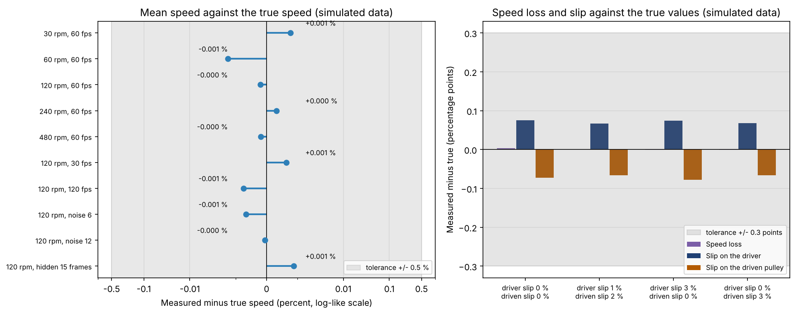
</p>

`python run_validation.py` makes simulated videos with known values, runs the analysis and compares. The full table is in [docs/validation.md](docs/validation.md).

- 40 of 40 checks are within their tolerance
- Mean speed from 30 to 480 rpm, at 30, 60 and 120 fps, with picture noise and with 15 lost frames: largest error 0.001 rpm
- Belt drive, four combinations of driver and driven slip: speed ratio exact to three decimals, speed loss within 0.003 points, slip within 0.08 points
- Speed wobble of 4 degrees at 3 Hz: dominant frequency 3.003 Hz, amplitude 12.38 rpm against 12.57 rpm
- A 120 rpm video read as 30 fps gives 60 rpm. The frame rate is the one number that has to be right, and the script checks the frame times of the file for a variable frame rate
- A gap of 16 frames at 12 degrees per frame cannot be bridged: the turn count across it is one turn short, while the speed is right. This is shown in the table as a known limit

With your own recording, compare against a reference you measured another way:

```
python run_validation.py --table outputs/clip_analysis.csv --reference-rpm 148 --reference-turns 37
python run_validation.py --video sample_data/clip.mp4
```

## Quick start

Python 3.10 or newer (developed and tested with Python 3.12).

```
git clone https://github.com/umairamir1305/smartbelt-vision.git
cd smartbelt-vision
python -m venv .venv
.venv\Scripts\activate          (Windows)   |   source .venv/bin/activate   (macOS, Linux)
pip install -r requirements.txt

python make_test_belt_video.py --belt --driver-slip-percent 1 --slip-percent 2
streamlit run app.py
```

`make_test_belt_video.py` writes a simulated belt drive into `sample_data/` and prints the full analysis command. In the app, choose "Use a file from sample_data", then "Two-pulley belt drive", and type in the centres and sizes that the script printed.

The same analysis from the command line (this is the command that the script prints):

```
python run_belt_drive.py sample_data/synthetic_belt_120rpm_ratio2_mark_dslip1_slip2_60fps.mp4 --driver-colour green --driven-colour orange --driver-centre 140 270 --driven-centre 464 270 --driver-region-radius 102 --driven-region-radius 204 --driver-radius-mm 23.085 --driven-radius-mm 46.170 --belt-colour blue --driver-marker-radius-mm 18.225 --driven-marker-radius-mm 36.450
```

It prints the speed ratio 2.0614, the speed loss +2.98 percent and the slip +1.07 percent on the driver and +1.93 percent on the driven pulley, and saves the table, the plots and a tracked video in `outputs/`. Add `--preview` first to check the marker colours on one frame.

One pulley:

```
python make_test_video.py --rpm 150 --ripple-deg 4 --ripple-hz 3 --noise 6
python run_analysis.py sample_data/synthetic_disc_150rpm_60fps.mp4 --colour green --centre 320 240
```

## Your own video

- Put a small matte marker of a saturated colour on each pulley, away from the centre (green, orange, blue, red, yellow and magenta are built in). Put a mark of a third colour on the belt if you want the slip
- Film square on to the pulleys, camera fixed, no zoom. 60 fps or more, bright even light, exposure and focus locked, no stabilisation
- Measure the effective radius of each pulley (centre to the middle of the belt) and the distance from the centre to each marker, in mm
- Open the app, check the grid and the colour mask on a few frames, then run
- For slip, record once without load and use the printed calibration factor (`--belt-speed-factor`) for the recordings with load

`pick_points.py` is a small window for clicking the marker colour, the rotation centre and the pulley edge, and prints the options for the command line.

## Scripts

| Script | What it does |
|---|---|
| `app.py` | Streamlit app |
| `run_analysis.py` | One pulley: tracking, angle, speed, spectrum, plots, CSV |
| `run_belt_drive.py` | Two pulleys, speed ratio, speed loss, belt mark and slip |
| `run_validation.py` | Validation on simulated videos, or against your own reference |
| `belt_calculators.py` | Friction coefficient (Euler-Eytelwein) and power difference from your own tension and torque values |
| `pick_points.py` | Click the marker colour, centre and edge |
| `inspect_video.py` | Size, frame rate, frame count of a video |
| `make_test_video.py`, `make_test_belt_video.py` | Simulated videos with known values |
| `tools/make_readme_images.py`, `tools/app_screenshots.py`, `tools/record_demo_video.py` | The pictures and the demo video (the last two need Playwright) |

## Project layout

```
app.py  run_analysis.py  run_belt_drive.py  run_validation.py  belt_calculators.py  pick_points.py ...
src/
  video_io.py        reading video, frame rate, frame times
  tracking.py        colour mask, marker blob, tracking quality, drawing
  kinematics.py      angle, rotation, speed
  signal_analysis.py smoothing, trend, spectrum, peaks
  belt_drive.py      ratio, speed loss, surface speeds
  slip_analysis.py   belt speed from the mark, slip, calculators
  pipeline.py        analyse_pulley, analyse_belt_drive, plots
  validation.py      error measures, time axis check
  report.py          rows of text and the HTML report
  app_support.py     what the app needs besides Streamlit
  synthetic.py       simulated videos
tests/               pytest
assets/  docs/  tools/  sample_data/  outputs/
```

## Tests

```
python -m pytest
```

## Good to know

- The frame rate in the file is the time base of every speed. A variable frame rate or a wrong value changes all speeds by the same factor
- Slip is a small difference of speeds that each carry the error of the scale and of the effective radii: 1 percent of error in the scale is about 1 percentage point of slip. The change between no load and load is more reliable than one value
- Friction coefficient and power loss are not measured from video. The calculators use your own tension and torque measurements and are labelled model-based
- A peak in the spectrum says that the speed varies at that frequency, not why
- The tracked video the app can write is an mp4v file: VLC plays it, a web browser may not

## Docs

| File | What is in it |
|---|---|
| [docs/equations.md](docs/equations.md) | Every formula the program uses, with the function that does it |
| [docs/validation.md](docs/validation.md) | The full validation table on simulated videos |
| [docs/real_recording_protocol.md](docs/real_recording_protocol.md) | How to record and check a real belt drive with a phone |
| [docs/report_template.md](docs/report_template.md) | Structure for an engineering report |
| [docs/presentation_outline.md](docs/presentation_outline.md) | 12 slides for a 10 minute talk |
| [docs/demo_video_script.md](docs/demo_video_script.md) | Script for a narrated demo |
| [docs/portfolio_text.md](docs/portfolio_text.md) | GitHub description, portfolio text, CV bullets |
| [docs/git_basics.md](docs/git_basics.md) | Commands for the first upload and after |

## Roadmap

- Results from real recordings next to the simulated ones (R1 to R5 in the recording protocol)

## License

MIT, see [LICENSE](LICENSE).
